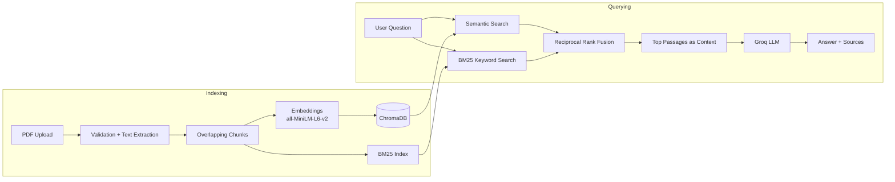

<div align="center">

# 🧠 Advanced RAG Knowledge Assistant

**Upload PDFs, ask questions, and get answers grounded in your documents — with sources.**


</div>

---

## 📖 Overview

**Advanced RAG Knowledge Assistant** is a full-stack Retrieval-Augmented Generation (RAG) application. Users upload PDF documents, the system indexes them, and a language model answers questions using only the passages retrieved from those documents, so answers can be traced back to their sources.

### Why hybrid retrieval?

Pure vector search understands *meaning* but can miss exact terms such as names, IDs, and acronyms. Pure keyword search finds exact terms but misses paraphrases. This project combines both:

- **Semantic search** with ChromaDB and `all-MiniLM-L6-v2` embeddings
- **Keyword search** with BM25
- **Reciprocal Rank Fusion (RRF)** to merge both rankings into one result list, with no score normalization needed

## ✨ Features

- 📄 Upload PDFs and index their contents
- ✂️ Text extraction with overlapping chunking to preserve context
- 🔎 Hybrid retrieval: ChromaDB semantic search + BM25, fused with RRF
- 💬 Question answering grounded in retrieved context, powered by Groq
- 📌 Source information returned with answers
- 🗂️ List and delete indexed documents through the API
- ⚛️ React + Vite frontend connected to a FastAPI backend
- 🛡️ PDF validation and file-size limits
- ✅ Automated tests for the API, indexing, and retrieval

## 🖼️ Screenshots

| Upload & Index | Ask & Get Sourced Answers |
|---|---|
|  |  |

<details>
<summary>API documentation (Swagger UI)</summary>


</details>

## 🏗️ Architecture



### How it works

1. **Upload:** The API validates the PDF (type and size) and extracts its text.
2. **Chunking:** Text is split into overlapping chunks so context is not lost at boundaries.
3. **Embedding:** Each chunk is embedded with `sentence-transformers/all-MiniLM-L6-v2`.
4. **Indexing:** Chunks and source metadata are stored in a persistent ChromaDB collection.
5. **Retrieval:** Semantic results and BM25 keyword results are merged using Reciprocal Rank Fusion.
6. **Generation:** The top passages are sent as context to the configured Groq language model.
7. **Sources:** The response includes source details so answers can be checked against the original documents.

## 🧰 Tech Stack

| Layer | Technology |
|---|---|
| Frontend | React, Vite, CSS |
| Backend | Python, FastAPI, Uvicorn |
| Vector store | ChromaDB |
| Embeddings | Sentence Transformers (`all-MiniLM-L6-v2`) |
| Keyword search | `rank-bm25` |
| PDF parsing | `pypdf` |
| LLM provider | Groq API |
| Testing | Pytest |

## 📁 Project Structure

```
Advanced-RAG-Knowledge-Assistant/
├── app/
│   ├── main.py                   # FastAPI app and routes
│   └── services/
│       ├── document_service.py   # Document listing / deletion
│       ├── ingestion_service.py  # PDF parsing and chunking
│       ├── vector_store.py       # ChromaDB + BM25 + RRF retrieval
│       └── rag_service.py        # Prompting and answer generation
├── frontend/                     # React + Vite UI
├── tests/
│   ├── test_api.py
│   ├── test_indexing.py
│   └── test_retrieval.py
├── docs/                         # Screenshots and demo GIF
├── data/                         # Local only (not committed)
│   ├── chroma_db/                # Vector database
│   └── documents/                # Uploaded PDFs
├── requirements.txt
├── .env                          # Local secrets (not committed)
├── .gitignore
└── README.md
```

## ✅ Prerequisites

- Python 3.10 or newer
- Node.js and npm
- Git
- A [Groq API key](https://console.groq.com/) (for answer generation)

```bash
python --version
node --version
npm --version
```

## 🚀 Getting Started

### 1. Clone the repository

```bash
git clone https://github.com/Yukesh1030/Advanced-RAG-Knowledge-Assistant.git
cd Advanced-RAG-Knowledge-Assistant
```

### 2. Set up the backend

**Windows (PowerShell):**

```powershell
python -m venv venv
.\venv\Scripts\Activate.ps1
python -m pip install --upgrade pip
pip install -r requirements.txt
```

**macOS / Linux:**

```bash
python3 -m venv venv
source venv/bin/activate
python -m pip install --upgrade pip
pip install -r requirements.txt
```

> The first run downloads the embedding model, so it may take a few minutes and needs an internet connection.

### 3. Configure your API key

Create a `.env` file in the repository root:

```env
GROQ_API_KEY=your_groq_api_key_here
```

Replace the placeholder with your own key. **Never commit `.env` or share your key.** The Groq model name is configured in the backend source code.

### 4. Start the backend

From the repository root, with the virtual environment activated:

```bash
python -m uvicorn main:app --app-dir app --reload --port 8000
```

| URL | Purpose |
|---|---|
| http://127.0.0.1:8000 | API base URL |
| http://127.0.0.1:8000/docs | Interactive Swagger documentation |
| http://127.0.0.1:8000/health | Health check |

### 5. Start the frontend

Open a second terminal:

```bash
cd frontend
npm install
npm run dev
```

Open the URL printed by Vite (commonly http://localhost:5173).

### 6. Try it out

1. Upload a PDF in the UI.
2. Wait for indexing to finish.
3. Ask a question about the document.
4. Review the answer and its sources.

## 🔌 API Reference

| Method | Endpoint | Description |
|---|---|---|
| `GET` | `/` | Basic API information |
| `GET` | `/health` | Health check |
| `GET` | `/documents` | List indexed documents |
| `POST` | `/upload` | Upload and index a PDF |
| `POST` | `/ask` | Ask a question about indexed content |
| `DELETE` | `/documents/{filename}` | Delete a document |

Full request/response schemas are available at `/docs` while the backend is running.

<details>
<summary>Example: ask a question with cURL</summary>

The request body may differ slightly from this sketch; check `/docs` for the exact schema.

```bash
curl -X POST "http://127.0.0.1:8000/ask" \
  -H "Content-Type: application/json" \
  -d '{"question": "What are the key points of the document?"}'
```

</details>

## 🧪 Running Tests

From the repository root, with the virtual environment activated:

```bash
python -m pytest -v
```

The test suite covers API behavior, document indexing, and retrieval.

## 🎯 Design Decisions

- **Hybrid retrieval over vector-only search.** Semantic search handles paraphrases; BM25 handles exact keywords. Fusing the two improves coverage for queries containing names, codes, or technical terms.
- **Reciprocal Rank Fusion.** RRF combines rankings by position rather than raw score, so cosine similarity and BM25 scores do not need to be normalized onto the same scale.
- **Overlapping chunks.** Overlap reduces the chance that an answer is split across a chunk boundary.
- **Source-grounded answers.** Returning source metadata lets users verify answers instead of trusting the model blindly.
- **Service-layer separation.** Ingestion, vector storage, document management, and generation live in separate modules, which keeps the code easier to test and extend.

## 🛣️ Roadmap

- [ ] Docker and docker-compose setup
- [ ] Streaming responses
- [ ] Retrieval evaluation (hit rate / MRR) comparing semantic-only vs. hybrid
- [ ] Support for DOCX, TXT, and web pages
- [ ] Re-ranking with a cross-encoder
- [ ] Conversation history and follow-up questions
- [ ] Cloud deployment with a live demo

## 🔒 Data & Security Notes

- Do not commit `.env` files, virtual environments, `node_modules`, local ChromaDB data, or uploaded PDFs.
- Do not upload confidential or personal documents while testing in a public repository or shared environment.
- Never place API keys in source code, screenshots, issues, or commits. If a key is ever exposed, revoke it and create a new one.
- Local ChromaDB data is ignored by Git. After cloning, re-upload your PDFs to rebuild the knowledge base.
- This README describes local development, not production deployment or hardening.

## 🩺 Troubleshooting

<details>
<summary><b><code>GROQ_API_KEY</code> is missing</b></summary>

- Check that `.env` exists in the repository root and contains your key.
- Restart the backend after changing environment variables.
- Don't share the key in logs, screenshots, or chat.

</details>

<details>
<summary><b>The frontend can't reach the API</b></summary>

- Confirm the backend is running on port `8000`.
- Check the API base URL configured in the frontend.
- Confirm the backend's CORS settings allow the frontend's local origin.

</details>

<details>
<summary><b>Answers aren't relevant</b></summary>

- Confirm the PDF uploaded and indexed successfully.
- Ask about something the uploaded document actually covers.
- Scanned PDFs without selectable text can't be read by text extraction (OCR isn't included).
- Re-index your documents if the local vector database was removed.

</details>

<details>
<summary><b>Dependency installation fails</b></summary>

- Confirm the virtual environment is active.
- Check your Python and Node.js versions.
- Upgrade pip: `python -m pip install --upgrade pip`.

</details>

## 🤝 Contributing

Suggestions and improvements are welcome.

1. Fork the repository
2. Create a branch: `git checkout -b feature/your-feature`
3. Commit your changes: `git commit -m "feat: add your feature"`
4. Push the branch: `git push origin feature/your-feature`
5. Open a Pull Request

## 📄 License

This project is licensed under the MIT License. See the [LICENSE](LICENSE) file for details.

## 👤 Author

**Yukesh G**

- GitHub: [@Yukesh1030](https://github.com/Yukesh1030)
- LinkedIn: [linkedin.com/in/yukesh-g](https://www.linkedin.com/in/yukesh-g)

---

<div align="center">

⭐ If you found this project useful, consider giving it a star!

</div>
